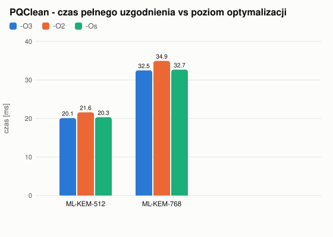
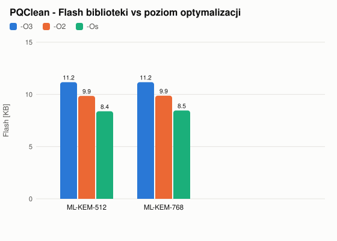

# Wyniki pomiarów - ML-KEM vs ECDH na STM32F446RE

Źródło czasów: `tests/v3.txt` (PQClean -O3), SYSCLK 168 MHz, cache ART włączony, 50 powtórzeń na operację, przerwania wyłączone podczas pomiaru.

## Powtarzalność

| Opt. PQClean | Logi | Wyniki identyczne |
|---|---|---|
| -O2 | v4-02.txt | tak |
| -O3 | v3.1.txt, v3.txt | tak |
| -Os | v4-0s.txt | tak |

Pominięte logi bez `RESULT: ALL OK`: v1.txt, v2.txt.

## 1. Czas operacji [ms] (średnia; min-max w cyklach)

| Implementacja | keygen | encaps / ECDH | decaps | wolfSSL asm (F439) keygen / enc / dec |
|---|---:|---:|---:|---|
| PQClean ML-KEM-512 | 5.95 | 6.53 | 7.63 | 4.03 / 3.82 / 5.05 |
| PQClean ML-KEM-768 | 9.66 | 10.65 | 12.18 | 6.52 / 6.57 / 8.33 |
| CMOX ML-KEM-512 | 4.66 | 13.98 | 15.57 | - |
| CMOX ML-KEM-768 | 7.56 | 20.13 | 22.33 | - |
| ECDH P-256 (CMOX) | 12.67 | 28.39 |  | 5.59 / 11.81 |
| ECDH X25519 (CMOX) | 25.74 | 25.56 |  | - |

## 2. Pełne uzgodnienie klucza (obie strony)

KEM: inicjator = keygen + decaps, odpowiadający = encaps. ECDH: każda strona = keygen + ECDH.

| Implementacja | Inicjator [ms] | Odpowiadający [ms] | Razem [ms] | Przesyłane dane [B] | vs P-256 |
|---|---:|---:|---:|---:|---:|
| PQClean ML-KEM-512 | 13.58 | 6.53 | 20.11 | 1568 | 4.1× szybciej |
| PQClean ML-KEM-768 | 21.85 | 10.65 | 32.50 | 2272 | 2.5× szybciej |
| CMOX ML-KEM-512 | 20.23 | 13.98 | 34.21 | 1568 | 2.4× szybciej |
| CMOX ML-KEM-768 | 29.89 | 20.13 | 50.01 | 2272 | 1.6× szybciej |
| ECDH P-256 (CMOX) | 41.06 | 41.06 | 82.12 | 128 | 1.0× |
| ECDH X25519 (CMOX) | 51.30 | 51.30 | 102.60 | 64 | 1.2× wolniej |

Przesyłane dane: ML-KEM = klucz publiczny + szyfrogram; ECDH = 2 klucze publiczne (P-256 bez bajtu 0x04, bez kompresji).

## 3. Pamięć RAM

Minimalny RAM algorytmu ≈ bufory kluczy + szczyt stosu + sterta + bufor roboczy CMOX.

| Implementacja | Bufory kluczy [B] | Szczyt stosu [B] | Sterta [B] | Bufor roboczy [B] | Razem ≈ [B] |
|---|---:|---:|---:|---:|---:|
| PQClean ML-KEM-512 | 3232 | 9608 | 208 | 0 | 13048 |
| PQClean ML-KEM-768 | 4704 | 14536 | 208 | 0 | 19448 |
| CMOX ML-KEM-512 | 3232 | 4736 | 0 | 0 | 7968 |
| CMOX ML-KEM-768 | 4704 | 5568 | 0 | 0 | 10272 |
| ECDH P-256 (CMOX) | 224 | 696 | 0 | 1612 | 2532 |
| ECDH X25519 (CMOX) | 128 | 696 | 0 | 496 | 1320 |

Stos zawiera ramki benchmarku i generatora losowego (~kilkaset B). Sterta 200 B w wierszach CMOX pochodzi z generatora losowego benchmarku, nie z CMOX - pominięta. PQClean alokuje kontekst SHAKE (200-208 B) przez malloc.

## 4. Pamięć Flash

| Implementacja | Opt. | Flash biblioteki [B] | Δ Flash obrazu vs baseline [B] |
|---|---|---:|---:|
| PQClean ML-KEM-512 | -O3 | 11436 | 12572 |
| PQClean ML-KEM-768 | -O3 | 11436 | 12572 |
| CMOX ML-KEM-512 | lib | 12700 | 18852 |
| CMOX ML-KEM-768 | lib | 12706 | 18852 |
| ECDH P-256 (CMOX) | lib | 20470 | 27256 |
| ECDH X25519 (CMOX) | lib | 13570 | 19740 |

Flash biblioteki: PQClean = ML-KEM + SHA-3 (fips202.c); CMOX = obiekty biblioteki (z własnym Keccakiem). Δ Flash zawiera też kod benchmarku dla danego algorytmu i - w wariantach CMOX - SHA-3 generatora losowego. Szczegóły: tests/size/size_report.md.

## 5. Poziom optymalizacji PQClean (czas vs Flash)

| Algorytm | Opt. | keygen [ms] | encaps [ms] | decaps [ms] | Razem [ms] | Szczyt stosu [B] | Flash biblioteki [B] |
|---|---|---:|---:|---:|---:|---:|---:|
| ML-KEM-512 | -O3 | 5.95 | 6.53 | 7.63 | 20.11 | 9608 | 11436 |
| ML-KEM-512 | -O2 | 6.43 | 7.05 | 8.12 | 21.60 | 9592 | 10092 |
| ML-KEM-512 | -Os | 5.86 | 6.61 | 7.85 | 20.32 | 9584 | 8586 |
| ML-KEM-768 | -O3 | 9.66 | 10.65 | 12.18 | 32.50 | 14536 | 11436 |
| ML-KEM-768 | -O2 | 10.44 | 11.51 | 13.00 | 34.95 | 14520 | 10116 |
| ML-KEM-768 | -Os | 9.55 | 10.71 | 12.42 | 32.67 | 14512 | 8662 |

CMOX jest gotową biblioteką binarną - poziom optymalizacji go nie dotyczy.

### Stabilność pomiaru między buildami

Operacje CMOX bez generatora losowego (decaps, ECDH) mają identyczny kod binarny w każdym buildzie; różnice wynikają tylko z innego rozmieszczenia kodu we Flash (ART cache).

| Operacja | -O3 [cykle] | -O2 [cykle] | -Os [cykle] | max różnica |
|---|---:|---:|---:|---:|
| CMOX ML-KEM-512 decaps | 2614955 | 2615044 | 2615040 | 0.003 % |
| CMOX ML-KEM-768 decaps | 3751292 | 3751419 | 3751412 | 0.003 % |
| CMOX P-256 ecdh | 4770135 | 4771803 | 4771798 | 0.035 % |
| CMOX X25519 ecdh | 4294793 | 4297762 | 4297757 | 0.069 % |

Operacje z losowością (keygen, encaps) różnią się nieco bardziej, bo generator benchmarku (SHAKE128 z PQClean) jest kompilowany z danym poziomem optymalizacji.

## Wykresy

![Pełne uzgodnienie klucza [ms]](full_exchange_ms.svg)
![Przesyłane dane [B]](bytes_on_air.svg)
![ML-KEM - czas operacji [ms]](kem_ops_ms.svg)
![Minimalny RAM [KB]](ram_kb.svg)
![Flash biblioteki [KB]](flash_kb.svg)

